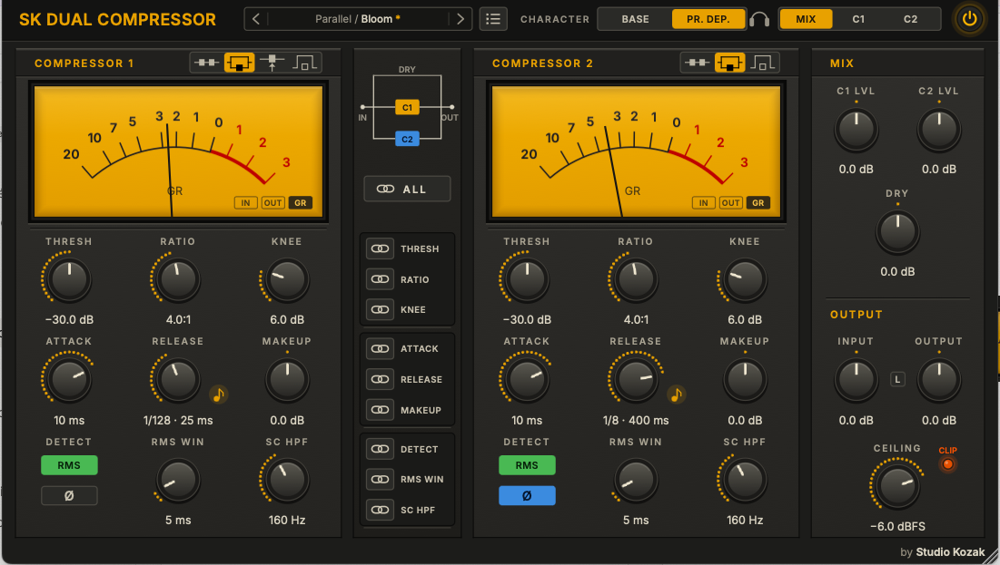
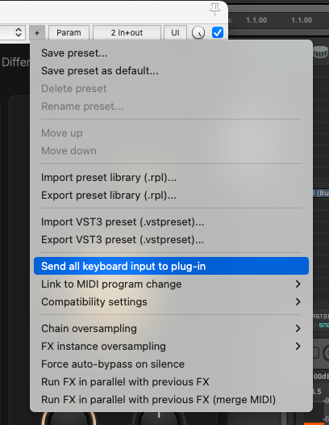

<p align="center">
  
</p>

<h1 align="center">SK Dual Compressor</h1>

<p align="center">
  <em>Two compressors. Twelve ways to make them work together.</em>
</p>

<p align="center">
  
</p>

<p align="center">
  <strong>
    <a href="https://github.com/studiokozak/SK-Dual-Compressor/releases/latest">
      Download Latest Release
    </a>
  </strong>
</p>

---

## Overview

Engineers have been chaining compressors for decades. A fast one to catch the peaks, a slow one to glue everything together. Or one squashed hard and blended under the dry signal. Usually that means two plugins, two windows, and a lot of back and forth.
SK Dual Compressor puts both compressors in one place and lets you decide how they are wired: one after the other, side by side with the dry signal, or with the first one quietly telling the second one when to work.
Both compressors are identical. Any setting of the second one can be linked to the first, so you can move them together or let them go their own way.

This is SK Dual Compressor: two compressors, and a patch bay.

---

## Features

* Two identical compressors in one plugin
* 12 routings: serial, parallel, side chain, bypass, and every useful combination
* Live routing diagram, so you always see how the signal flows
* Link any setting of Compressor 2 to Compressor 1, one by one or all at once
* Release synced to the host tempo
* Two release behaviours: steady or program-dependent
* VU meters showing gain reduction, input or output level
* Independent levels for each branch and for the dry signal
* Solo each compressor with the Monitor buttons
* Polarity switch on each compressor
* Sidechain high-pass filter on each compressor
* Soft output ceiling, 4× oversampled
* Input/Output linked gain staging
* Built-in preset manager with folders
* Mono and stereo
* VST3 (Windows & macOS)
* Audio Unit (macOS)
* Intel & Apple Silicon support

---

## Controls

The interface reads from left to right: Compressor 1, the routing and links in the middle, Compressor 2, then the mix and output section. The header holds the global settings.

---

### HEADER

#### CHARACTER (BASE / PR. DEP.)

Sets how both compressors recover after compressing. It is shared by the two compressors.
BASE gives a steady, predictable recovery. Same behaviour on every hit.
PR. DEP. (program-dependent) lets the recovery adapt to the music: quick after short hits, slower after long or loud passages. It usually sounds more natural and more alive.

#### MONITOR (MIX / C1 / C2)

MIX is the normal mode: you hear the full routing.
C1 and C2 let you hear one compressor on its own, at unity gain, exactly where it sits in the routing. The branch levels of the MIX section are bypassed while you do this, so do not be surprised if turning them changes nothing. A bypassed compressor is silent here. If Compressor 1 is set to Side Chain, C1 plays the signal Compressor 2 is listening to.

---

### COMPRESSOR 1 / COMPRESSOR 2

Both compressors have the same controls.

#### ROUTING

The four small icons in the title bar of each compressor set how it is wired. Hover over an icon and its name replaces the compressor title.

* **SERIAL**: the compressor sits in the main signal path.
* **PARALLEL**: the compressor runs alongside the dry signal, and both are mixed in the MIX section.
* **SIDE CHAIN** (Compressor 1 only): Compressor 1 no longer reaches the output. Its compressed signal becomes what Compressor 2 listens to.
* **BYPASS**: the compressor is out of the way. It keeps running in the background, so it never restarts cold when you switch it back on.

Combined, the two compressors offer 12 routings, drawn live in the centre column. A few examples:

* Serial / Serial: input, Compressor 1, Compressor 2, output.
* Parallel / Parallel: dry, Compressor 1 and Compressor 2, all mixed together.
* Parallel / Serial: dry, plus Compressor 1 followed by Compressor 2.
* Side Chain / Serial: you hear Compressor 2 alone, reacting to what Compressor 1 lets through.

Switching routings fades the output out and back in over a few milliseconds, so it never clicks.

#### VU METER (IN / OUT / GR)

The three buttons at the bottom right of the meter choose what it shows.
GR, the default, shows how much the compressor is pushing the sound down. The needle rests on 0 and moves left as it compresses.
IN and OUT show the level entering and leaving the compressor, like a classic analogue VU meter.
0 VU equals −18 dBFS. Handy to check what reaches Compressor 2 when the two are in series.
Some will say this value makes no sense in the digital world. I gladly hear their arguments, but I simply followed the recommendation of the European Broadcasting Union [EBU R 68](https://tech.ebu.ch/files/live/sites/tech/files/shared/r/r068.pdf). Our American friends will object that 2 dB should be taken off, but I live in Paris, which is in France, and therefore in Europe. I hope everyone will forgive my chauvinism here. :)

#### THRESHOLD

The level above which the compressor starts working. Lower it and more of your sound gets compressed.

#### RATIO

How firmly the compressor holds the sound down once it crosses the threshold.

#### KNEE

How gently the compressor starts working as the sound approaches the threshold. Low values are abrupt, higher values ease in smoothly.

#### ATTACK

How quickly the compressor grabs the sound. Very short settings catch the very first instant. Longer settings let the initial snap through before anything happens.

#### RELEASE

How quickly the compressor lets go once the sound drops.
The note button next to the knob syncs the release to the tempo of your project, from a quarter note down to 1/128, straight, triplet or dotted. It follows tempo changes too. Turning the knob by hand switches the sync off.

#### MAKEUP

The output level of the compressor, from −24 to +24 dB. Use it to bring back what the compression took away, or to lower what goes into Compressor 2 when the two are in series.

#### DETECT (PEAK / RMS)

PEAK reacts to every short spike. RMS reacts to the average loudness, which feels smoother and less nervous.

#### Ø (POLARITY)

Flips the polarity of the compressor output. Mostly useful in parallel, where it can cancel or reshape what the other branches do.

#### RMS WIN

How long the RMS detector averages the sound. Short values stay close to PEAK, long values get lazier. Only active in RMS mode.

#### SC HPF

Makes the compressor ignore low frequencies when deciding how hard to work. Useful when a kick or a bass keeps triggering it on its own. It only changes what the compressor *listens to*, never what you *hear*. Set below 20 Hz, it is off.

---

### LINKS

The centre column, under the routing diagram, holds one link button per setting.
When a link is on, the setting of Compressor 2 copies Compressor 1 and follows it, automation included. The matching knob of Compressor 2 is greyed out. Turn the link off and Compressor 2 keeps the last value it received.
ALL links every setting at once, or unlinks them all if they are already linked.
Linking RELEASE also links its tempo sync.

---

### MIX & OUTPUT

#### C1 LVL / C2 LVL / DRY

The level of each branch when the routing mixes several of them together. Fully left is silence, the middle is 0 dB.
A knob is greyed out when its branch is not part of a mix. In a fully serial routing, none of them is needed.

#### INPUT

Sets the level entering both compressors. Pushing it makes them work harder, much like lowering the thresholds.

#### INPUT/OUTPUT LINK (L)

Links INPUT and OUTPUT. When enabled, raising the input automatically lowers the output by the same amount, so you can drive the compressors harder without the overall level jumping around.

#### OUTPUT

Sets the final output level.

#### CEILING

A safety limit at the very end of the chain: your sound will not go above the level you set here. Instead of clipping harshly as it gets close, it gently rounds off the loudest peaks. The clip light shows when it is working.

---

### Presets

Click the preset name in the header to open the preset panel. Save your settings, name them, rename them and sort them into folders. The arrows on each side of the name step through your presets.
There are no factory presets, only Init. Every source is different, and the right settings depend on yours.
Power, Monitor, Input, Output and the L button are not stored in presets, so loading one never changes your gain staging.

**Reaper users:** by default, Reaper keeps keyboard shortcuts for itself. Press the space bar while naming a preset and your song starts playing instead of a space being typed. To fix this, click the + button at the top of the plugin window and enable Send all keyboard input to plug-in. Keep in mind that while this option is on and the plugin window has focus, the space bar will not start or stop playback, so you may want to switch it back off once your presets are named.

<p align="center">
  
</p>

---

### Power

The button in the header engages or bypasses the processing.

---

## Typical Applications

SK Dual Compressor may work particularly well on:

* Vocals: a fast compressor for the peaks, then a slow one for the overall level
* Drum buses: parallel compression with control over every branch
* Bass
* Acoustic guitars
* Mix buses
* Anything that needs both control and life

And a well-kept "secret", waiting for you in the Notes section below. ;)

---

## System Requirements

### Windows

* Windows 10 or later
* VST3 compatible host
* VST3 format

### macOS

* macOS 11 Big Sur or later
* Intel or Apple Silicon
* VST3 and Audio Unit (AU) formats
* Compatible VST3 or Audio Unit host

---

## Installation

### Windows

Copy:

`SK Dual Compressor.vst3`

to:

`C:\Program Files\Common Files\VST3`

Then restart your DAW.

### macOS

#### VST3 Version

Copy:

`SK Dual Compressor.vst3`

to:

`/Library/Audio/Plug-Ins/VST3`

#### Audio Unit Version

Copy:

`SK Dual Compressor.component`

to:

`/Library/Audio/Plug-Ins/Components`

Then restart your DAW.

---

### macOS Security

SK Dual Compressor is built as a Universal Binary and supports both Intel and Apple Silicon Macs.
Depending on your macOS security settings, you may need to authorize the plugin manually the first time it is loaded, from System Settings > Privacy & Security.

If your DAW still refuses to load it, open Terminal and run:

```
xattr -dr com.apple.quarantine "/Library/Audio/Plug-Ins/VST3/SK Dual Compressor.vst3"
xattr -dr com.apple.quarantine "/Library/Audio/Plug-Ins/Components/SK Dual Compressor.component"
```

---

## Notes

Nobody knows where it came from, but here is the "secret".
Set both compressors to Parallel, Dry at 0 dB, the same level for C1 and C2, invert the polarity of Compressor 2, link everything except Release, and give Compressor 1 a shorter release than Compressor 2.
The two compressors now cancel each other out, except in the short moment where one has let go of the sound and the other has not. What you hear is your original sound plus that difference: the body of a snare, a tom or a kick grows longer and fuller, while the attack stays untouched. Link Release too and the difference disappears completely.
If you would like a plugin built entirely around this trick, have a look at [SK Bloom](https://github.com/studiokozak/SK-Bloom).

---

Hope you enjoy SK Dual Compressor.

*Stéphan (Studio Kozak)*
